# Hospital Scheduling System — Product & Engineering Sync

_Generated by Planar on 2026-10-12 09:24 UTC._

## Decisions (21)

- **DEC-001** Basic accessibility checks are part of the first release.
  > (Maya, L27) “Yes, basic accessibility checks are part of the first release.”

- **DEC-002** Room availability needs to be considered when generating slots.
  > (Arjun, L33) “Okay, so room availability needs to be considered when generating slots.”

- **DEC-003** Configurable department-level buffers will be supported.
  > (Maya, L57) “Good. Let's include configurable department-level buffers in the requirements.”

- **DEC-004** A date-based list will be used for patients and staff.
  > (Maya, L67) “Let's start with a date-based list for patients and staff. We can revisit the calendar later.”

- **DEC-005** Cancellation window is configurable per department with a default of two hours.
  > (Maya, L89) “That seems sensible. Let's support it, with a default of two hours.”

- **DEC-006** Manual overrides should record the staff member and the reason.
  > (Maya, L95) “Agreed. Manual overrides should record the staff member and the reason.”

- **DEC-007** SMS only for the first release. WhatsApp is parked.
  > (Maya, L117) “Agreed. SMS only for the first release. Let's park WhatsApp.”

- **DEC-008** A reminder twenty-four hours before an appointment will be sent.
  > (Maya, L121) “Yes, a reminder twenty-four hours before an appointment.”

- **DEC-009** Appointments with rescheduling required will have a status of "rescheduling required".
  > (L157–161) “Priya: So perhaps a status like "rescheduling required"? … Maya: Yes, let's introduce that status. … Arjun: I'll update the appointment state model.”

- **DEC-010** Audit trail for creation, cancellation, rescheduling, and manual overrides will be included.
  > (Maya, L233) “Let's include an audit trail for creation, cancellation, rescheduling, and manual overrides.”

- **DEC-011** Department-level access control will be implemented.
  > (Arjun, L247) “We need department-level access control, then.”

- **DEC-012** Patient self-service will use phone-number verification.
  > (Maya, L275) “Let's use phone-number verification for patient self-service, assuming we can get the security review approved.”

- **DEC-013** Internal demonstration is the target by the end of October.
  > (Maya, L285) “The target is to have an internal demonstration by the end of October.”

- **DEC-014** Basic appointment counts and cancellation counts will be included in reporting.
  > (Maya, L301) “Basic appointment counts and cancellation counts would be helpful.”

- **DEC-015** Offline editing is not built for the first release.
  > (Maya, L325) “We're not building offline editing for the first release.”

- **DEC-016** Print-friendly view for daily schedule will be included.
  > (Priya, L329) “That's straightforward. We can provide a print-friendly view.”

- **DEC-017** The core scheduling model will support rooms, department buffers, cancellation rules, and rescheduling status.
  > (Arjun, L345) “Correct. The core scheduling model will support rooms, department buffers, cancellation rules, and rescheduling status.”

- **DEC-018** Do not automatically offer the slot to the next person in the queue.
  > (Priya, L173) “We could automatically offer the slot to the next person in the queue.”

- **DEC-019** Do not build care plans in this release.
  > (L203–205) “Priya: Are we building care plans in this release? … Maya: No, that's outside our scope.”

- **DEC-020** Do not track waiting-room delays.
  > (L311–315) “Rahul: Are we tracking waiting-room delays? … Dr. Meera: That would require recording actual arrival and consultation times. We don't have that workflow defined. … Maya: Then let's park waiting-time analytics for a later phase.”

- **DEC-021** Do not include charts, exports, and department comparisons in the first release.
  > (Maya, L305) “No, not in the first release. A basic summary is enough.”

## Requirements (22)

- **REQ-001** Initially, SMS notifications should be sent for cancellations and reminders.
  > (L97–101) “Priya: Should the patient receive a cancellation notification? … Maya: Yes, by SMS initially. … Arjun: Are we integrating with an SMS provider now?”

- **REQ-002** Reminders must be sent twenty-four hours before appointments unless created less than twenty-four hours in advance.
  - From: DEC-008
  > (L121–123) “Maya: Yes, a reminder twenty-four hours before an appointment. … Dr. Meera: Unless the appointment was created less than twenty-four hours in advance.”

- **REQ-003** The system should invalidate queued reminder jobs if the appointment time changes.
  > (L133–135) “Priya: What happens if the appointment time changes after the reminder has already been queued? … Arjun: The queued job should be invalidated, and a new reminder should be scheduled.”

- **REQ-004** Appointments must have a status of 'rescheduling required' if the assigned doctor becomes unavailable.
  - From: DEC-009
  > (Maya, L153) “Good question. If the doctor is unavailable, we shouldn't treat them as confirmed.”

- **REQ-005** The system must log all appointment changes including staff member, timestamp, and reason.
  - From: DEC-006
  > (L227–229) “Maya: Yes, log the staff member, timestamp, and reason. … Arjun: Do we need a full audit log for every appointment change?”

- **REQ-006** The system must enforce department-level access control for appointments.
  - From: DEC-011
  > (L247–249) “Arjun: We need department-level access control, then. … Rahul: And we should test direct API access, not just hide buttons in the frontend.”

- **REQ-007** The system must not store medical history or clinical notes for patients.
  > (L255–257) “Maya: No. We're building scheduling, not an electronic health record system. … Dr. Meera: We need enough information to identify the patient and contact them, but not their clinical notes.”

- **REQ-008** Patient registration must be done manually for the pilot, with integration point separate.
  > (Maya, L267) “For the pilot, let's support manual patient registration, but keep the integration point separate.”

- **REQ-009** The system must support a list-based schedule for the first release, with calendar support planned later.
  > (Priya, L349) “And I'll keep the first release focused on the list-based schedule rather than a full calendar.”

- **REQ-010** The system must track the number of appointments requiring rescheduling due to doctor absences.
  - From: DEC-009
  > (Maya, L309) “Let's include a count of appointments requiring rescheduling in the summary.”

- **REQ-011** The system must not support offline editing for the first release.
  - From: DEC-015
  > (L323–325) “Arjun: Offline editing is a different level of complexity. We'd need conflict resolution when connectivity returns. … Maya: We're not building offline editing for the first release.”

- **REQ-012** The SMS provider must be selected before enabling notifications.
  > (Maya, L343) “Great. Before we close, the SMS provider is still unselected, waitlist automation is undecided, and patient self-service depends on the security review.”

- **REQ-013** The system should allow manual overrides for cancellations with recorded staff member and reason.
  - From: DEC-006
  - Risks: RSK-001
  > (L93–95) “Dr. Meera: Receptionists need an override. They should record why they're doing it. … Maya: Agreed. Manual overrides should record the staff member and the reason.”

- **REQ-014** The system should not allow patients to book overlapping appointments unless explicitly supported.
  > (Maya, L213) “For self-service booking, we should block overlapping appointments unless there's an explicitly supported exception.”

- **REQ-015** The system must include configurable department-level buffer durations for appointment scheduling.
  - From: DEC-003
  > (Maya, L57) “Good. Let's include configurable department-level buffers in the requirements.”

- **REQ-016** The system must not allow self-service booking without phone-number verification until security review approval.
  - From: DEC-012
  - Risks: RSK-003
  > (Maya, L275) “Let's use phone-number verification for patient self-service, assuming we can get the security review approved.”

- **REQ-017** The system must not automatically reschedule appointments when a doctor becomes unavailable.
  > (L141–145) “Priya: Move them automatically to another doctor? … Dr. Meera: No, absolutely not. Patients may have specifically chosen that doctor. … Maya: We could generate a list of affected appointments and let the receptionist contact patients.”

- **REQ-018** The system must not track waiting-room delays or actual arrival times in the first release.
  - From: DEC-020
  > (L313–315) “Dr. Meera: That would require recording actual arrival and consultation times. We don't have that workflow defined. … Maya: Then let's park waiting-time analytics for a later phase.”

- **REQ-019** The system must not support waitlist automation in the initial release.
  > (Maya, L189) “Okay, waitlist automation stays undecided. It isn't required for the initial release.”

- **REQ-020** The system must include a status of 'rescheduling required' for affected appointments without changing the assigned doctor.
  - From: DEC-009
  > (L157–163) “Priya: So perhaps a status like "rescheduling required"? … Maya: Yes, let's introduce that status. … Rahul: We need to test what happens when a doctor becomes unavailable after appointments have already been booked.”

- **REQ-021** The system should warn receptionists about overlapping appointments with an override option.
  > (Dr. Meera, L207) “Then receptionists should at least be warned about overlapping appointments rather than having the system silently allow them.”

- **REQ-022** The system should not allow the system to silently allow overlapping appointments.
  > (Dr. Meera, L207) “Then receptionists should at least be warned about overlapping appointments rather than having the system silently allow them.”

## Tasks (15)

- [ ] **TSK-001** Document API contracts _(medium; owner: Arjun)_
  Arjun will document the API contracts once the appointment states are finalized
  - Done when (suggested): API contracts are documented
  - Done when (suggested): Appointment states are finalized
  > (Arjun, L335) “I'll document the API contracts once the appointment states are finalized.”

- [ ] **TSK-002** Implement daily schedule UI _(medium; owner: Priya)_
  Priya will start with the daily schedule, appointment creation, and cancellation screens
  - Done when (suggested): Daily schedule UI is implemented
  - Done when (suggested): Appointment creation and cancellation screens are functional
  > (Priya, L337) “I'll start with the daily schedule, appointment creation, and cancellation screens.”

- [ ] **TSK-003** Review patient flow for accessibility _(medium; owner: Neha)_
  Neha will review the patient flow for accessibility and make sure the status labels are understandable
  - Done when (suggested): Patient flow is accessible
  - Done when (suggested): Status labels are understandable
  > (Neha, L339) “I'll review the patient flow for accessibility and make sure the status labels are understandable.”

- [ ] **TSK-004** Coordinate with receptionists to validate workflows _(medium; owner: Dr. Meera)_
  Dr. Meera will coordinate with receptionists to validate the proposed workflows
  - Done when (suggested): Receptionists validate proposed workflows
  - Done when (suggested): Workflows are confirmed as functional
  > (Dr. Meera, L341) “I'll coordinate with receptionists to validate the proposed workflows.”

- [ ] **TSK-005** Add print-friendly view _(medium; owner: Priya)_
  Priya will provide a print-friendly view so receptionists can print the daily schedule
  - Done when (suggested): Print-friendly view is available
  - Done when (suggested): Receptionists can print the daily schedule
  > (Priya, L329) “That's straightforward. We can provide a print-friendly view.”

- [ ] **TSK-006** Add print-layout check to acceptance tests _(medium; owner: Rahul)_
  Rahul will add a print-layout check to the acceptance tests
  - Done when (suggested): Print-layout check is in acceptance tests
  - Done when (suggested): Print-friendly view is validated
  > (Rahul, L333) “I'll add a print-layout check to the acceptance tests.”

- [ ] **TSK-007** Finalize appointment state model _(medium; owner: Arjun)_
  Arjun will update the appointment state model to include 'rescheduling required' status
  - Done when (suggested): Appointment state model includes 'rescheduling required' status
  - Done when (suggested): Model is updated and confirmed
  - Implements: REQ-020, REQ-004
  > (Arjun, L161) “I'll update the appointment state model.”

- [ ] **TSK-008** Implement notification retries with idempotency _(medium; owner: Arjun)_
  Arjun will implement notification retries with an idempotency key based on the appointment ID and notification type
  - Done when (suggested): Idempotency key is implemented
  - Done when (suggested): Notification retries work without duplicates
  > (Arjun, L131) “We can use an idempotency key based on the appointment ID and notification type.”

- [ ] **TSK-009** Implement audit trail for appointment changes _(medium; owner: Arjun)_
  Arjun will make the audit records append-only at the application level
  - Done when (suggested): Audit records are append-only
  - Done when (suggested): All appointment changes are logged
  > (Arjun, L235) “I'll make the audit records append-only at the application level.”

- [ ] **TSK-010** Verify API access restrictions for audit logs _(medium; owner: Rahul)_
  Rahul will verify that ordinary users can't edit or delete audit records through the API
  - Done when (suggested): Audit logs are not editable or deletable via API
  - Done when (suggested): Access restrictions are verified
  > (Rahul, L237) “We should verify that ordinary users can't edit or delete audit records through the API.”

- [ ] **TSK-011** Implement configurable department buffers _(medium; owner: Arjun)_
  Arjun will store a configurable buffer duration against each department
  - Done when (suggested): Department buffers are configurable
  - Done when (suggested): Buffer durations are stored per department
  > (Arjun, L55) “We can store a configurable buffer duration against each department.”

- [ ] **TSK-012** Implement configurable room availability in slots _(medium; owner: Arjun)_
  Arjun will adjust slot-generation logic to consider room availability
  - Done when (suggested): Slots consider room availability
  - Done when (suggested): Slot-generation logic is updated
  > (Arjun, L33) “Okay, so room availability needs to be considered when generating slots.”

- [ ] **TSK-013** Implement notification system with SMS provider _(medium; owner: Arjun)_
  Arjun will implement the notification interface abstracting the SMS provider
  - Done when (suggested): Notification interface abstracts SMS provider
  - Done when (suggested): SMS notifications are supported
  - Implements: REQ-012
  > (Arjun, L105) “That affects the notification interface, although we can abstract the provider.”

- [ ] **TSK-014** Implement rescheduling status for affected appointments _(medium; owner: Arjun)_
  Arjun will mark affected appointments as requiring rescheduling without changing their assigned doctor
  - Done when (suggested): Rescheduling status is implemented
  - Done when (suggested): Appointments marked as requiring rescheduling
  - Implements: REQ-020, REQ-004
  > (Arjun, L149) “We could mark the affected appointments as requiring rescheduling without changing their assigned doctor.”

- [ ] **TSK-015** Implement warning for overlapping appointments _(medium; owner: Priya)_
  Priya will make the warning explicit and include the conflicting appointment details
  - Done when (suggested): Warning is explicit
  - Done when (suggested): Conflicting appointment details are included
  > (Priya, L223) “I'll make the warning explicit and include the conflicting appointment details.”

## Risks (8)

- **RSK-001** [medium] Manual overrides could lead to inconsistent appointment statuses.
  - Affects: REQ-013
  > (Maya, L95) “Agreed. Manual overrides should record the staff member and the reason.”

- **RSK-002** [medium] Waitlist automation could introduce race conditions.
  > (Arjun, L179) “That introduces reservation locks and race conditions. Two patients shouldn't be able to claim the same slot.”

- **RSK-003** [medium] Patient self-service could be blocked by security review delays.
  - Affects: REQ-016
  > (Maya, L275) “Let's use phone-number verification for patient self-service, assuming we can get the security review approved.”

- **RSK-004** [high] Audit logs could be tampered with if API access isn't restricted.
  > (Rahul, L237) “We should verify that ordinary users can't edit or delete audit records through the API.”

- **RSK-005** [medium] Notification retries could cause duplicate reminders.
  > (L129–131) “Rahul: How do we prevent duplicate reminders if the notification worker retries? … Arjun: We can use an idempotency key based on the appointment ID and notification type.”

- **RSK-006** [medium] Appointment rescheduling could require manual intervention.
  > (Maya, L233) “Let's include an audit trail for creation, cancellation, rescheduling, and manual overrides.”

- **RSK-007** [medium] Notification delays could affect patient communication.
  > (Arjun, L105) “That affects the notification interface, although we can abstract the provider.”

- **RSK-008** [high] Appointment conflicts could be silently allowed without staff confirmation.
  > (Maya, L209) “Let's do that for now. Show a warning and require staff confirmation.”

## Open questions (5)

- **OQ-001** Which SMS provider to use?
  Integration is needed but not selected.
  > (L101–103) “Arjun: Are we integrating with an SMS provider now? … Maya: We need to, but I haven't selected one.”

- **OQ-002** Should waitlist automation be implemented?
  Feature is undecided and requires further discussion.
  > (Maya, L189) “Okay, waitlist automation stays undecided. It isn't required for the initial release.”

- **OQ-003** How to handle slot reservations for waitlists?
  Requires defining hold duration and race conditions.
  > (Arjun, L179) “That introduces reservation locks and race conditions. Two patients shouldn't be able to claim the same slot.”

- **OQ-004** What is the exact policy for notification delivery?
  Need to define how to handle late notifications.
  > (Rahul, L183) “How long is the hold? And what happens if the notification arrives late?”

- **OQ-005** What is the exact policy for cancellation overrides?
  Need to define how to record staff actions.
  > (Maya, L95) “Agreed. Manual overrides should record the staff member and the reason.”

## Implementation plan: Hospital Scheduling System — Product & Engineering Sync

The plan builds a scheduling system with SMS notifications, department buffers, and rescheduling status. Key constraints include configurable buffers, no offline editing, and no care plans.

1. **Define Appointment States** _(REQ-004, REQ-020, TSK-007)_
   Arjun will update the appointment state model to include 'rescheduling required' status
2. **Implement Department Buffers** _(DEC-003, REQ-015, TSK-011)_
   Arjun will store a configurable buffer duration against each department
3. **Adjust Slot Generation for Room Availability** _(DEC-002, TSK-012)_
   Arjun will adjust slot-generation logic to consider room availability
4. **Implement Notification System with SMS Provider** _(DEC-007, REQ-001, REQ-012, TSK-013)_
   Arjun will implement the notification interface abstracting the SMS provider
5. **Implement Reminder Logic with 24-Hour Rule** _(REQ-002)_
   Send reminders 24 hours before appointments unless created less than 24 hours in advance.
6. **Add Print-Friendly Daily Schedule View** _(DEC-016, REQ-009, TSK-005)_
   Priya will provide a print-friendly view so receptionists can print the daily schedule
7. **Implement Audit Trail for Changes** _(DEC-010, REQ-005, TSK-009)_
   Arjun will make the audit records append-only at the application level
8. **Verify API Access Restrictions for Audit Logs** _(TSK-010)_
   Rahul will verify that ordinary users can't edit or delete audit records through the API
9. **Implement Rescheduling Status for Affected Appointments** _(DEC-009, REQ-004, REQ-010, REQ-020, TSK-014)_
   Arjun will mark affected appointments as requiring rescheduling without changing their assigned doctor
10. **Add Warning for Overlapping Appointments** _(REQ-021, REQ-022, TSK-015)_
   Priya will make the warning explicit and include the conflicting appointment details
11. **Validate Workflows with Receptionists** _(TSK-004)_
   Dr. Meera will coordinate with receptionists to validate the proposed workflows
12. **Review Patient Flow for Accessibility** _(DEC-001, REQ-007, TSK-003)_
   Neha will review the patient flow for accessibility and make sure the status labels are understandable
13. **Implement Notification Retries with Idempotency** _(TSK-008)_
   Arjun will implement notification retries with an idempotency key based on the appointment ID and notification type
14. **Document API Contracts** _(TSK-001)_
   Arjun will document the API contracts once the appointment states are finalized
15. **Build Daily Schedule UI** _(REQ-009, TSK-002)_
   Priya will start with the daily schedule, appointment creation, and cancellation screens
16. **Add print-layout check to acceptance tests** _(TSK-006)_
   Rahul will add a print-layout check to the acceptance tests

### Done when (suggested)

- [ ] Appointment state model includes 'rescheduling required' status
- [ ] Model is updated and confirmed
- [ ] Department buffers are configurable
- [ ] Buffer durations are stored per department
- [ ] Slots consider room availability
- [ ] Slot-generation logic is updated
- [ ] Notification interface abstracts SMS provider
- [ ] SMS notifications are supported
- [ ] Print-friendly view is available
- [ ] Receptionists can print the daily schedule
- [ ] Audit records are append-only
- [ ] All appointment changes are logged
- [ ] Audit logs are not editable or deletable via API
- [ ] Access restrictions are verified
- [ ] Rescheduling status is implemented
- [ ] Appointments marked as requiring rescheduling
- [ ] Warning is explicit
- [ ] Conflicting appointment details are included
- [ ] Receptionists validate proposed workflows
- [ ] Workflows are confirmed as functional

## Plan map

```mermaid
flowchart LR
  subgraph why["Decisions"]
    DEC_003["DEC-003: Configurable department-level buffers will be s…"]
    DEC_002["DEC-002: Room availability needs to be considered when g…"]
    DEC_007["DEC-007: SMS only for the first release. WhatsApp is par…"]
    DEC_016["DEC-016: Print-friendly view for daily schedule will be…"]
    DEC_010["DEC-010: Audit trail for creation, cancellation, resched…"]
    DEC_009["DEC-009: Appointments with rescheduling required will ha…"]
    DEC_001["DEC-001: Basic accessibility checks are part of the firs…"]
    DEC_008["DEC-008: A reminder twenty-four hours before an appointm…"]
    DEC_006["DEC-006: Manual overrides should record the staff member…"]
  end
  subgraph what["Requirements"]
    REQ_004["REQ-004: Appointments must have a status of 'reschedulin…"]
    REQ_020["REQ-020: The system must include a status of 'rescheduli…"]
    REQ_015["REQ-015: The system must include configurable department…"]
    REQ_001["REQ-001: Initially, SMS notifications should be sent for…"]
    REQ_012["REQ-012: The SMS provider must be selected before enabli…"]
    REQ_002["REQ-002: Reminders must be sent twenty-four hours before…"]
    REQ_009["REQ-009: The system must support a list-based schedule f…"]
    REQ_005["REQ-005: The system must log all appointment changes inc…"]
    REQ_010["REQ-010: The system must track the number of appointment…"]
    REQ_021["REQ-021: The system should warn receptionists about over…"]
    REQ_022["REQ-022: The system should not allow the system to silen…"]
    REQ_007["REQ-007: The system must not store medical history or cl…"]
  end
  subgraph how["Plan steps"]
    STEP_001["1. Define Appointment States"]
    STEP_002["2. Implement Department Buffers"]
    STEP_003["3. Adjust Slot Generation for Room Availability"]
    STEP_004["4. Implement Notification System with SMS Provider"]
    STEP_005["5. Implement Reminder Logic with 24-Hour Rule"]
    STEP_006["6. Add Print-Friendly Daily Schedule View"]
    STEP_007["7. Implement Audit Trail for Changes"]
    STEP_008["8. Verify API Access Restrictions for Audit Logs"]
    STEP_009["9. Implement Rescheduling Status for Affected Appo…"]
    STEP_010["10. Add Warning for Overlapping Appointments"]
    STEP_011["11. Validate Workflows with Receptionists"]
    STEP_012["12. Review Patient Flow for Accessibility"]
    STEP_013["13. Implement Notification Retries with Idempotency"]
    STEP_014["14. Document API Contracts"]
    STEP_015["15. Build Daily Schedule UI"]
    STEP_016["16. Add print-layout check to acceptance tests"]
  end
  subgraph who["Owners"]
    OWNER_Arjun(["Arjun"])
    OWNER_Priya(["Priya"])
    OWNER_Rahul(["Rahul"])
    OWNER_Dr__Meera(["Dr. Meera"])
    OWNER_Neha(["Neha"])
  end
  REQ_004 --> STEP_001
  REQ_020 --> STEP_001
  STEP_001 --> OWNER_Arjun
  REQ_015 --> STEP_002
  DEC_003 --> STEP_002
  STEP_002 --> OWNER_Arjun
  DEC_002 --> STEP_003
  STEP_003 --> OWNER_Arjun
  REQ_001 --> STEP_004
  REQ_012 --> STEP_004
  DEC_007 --> STEP_004
  STEP_004 --> OWNER_Arjun
  REQ_002 --> STEP_005
  REQ_009 --> STEP_006
  DEC_016 --> STEP_006
  STEP_006 --> OWNER_Priya
  REQ_005 --> STEP_007
  DEC_010 --> STEP_007
  STEP_007 --> OWNER_Arjun
  STEP_008 --> OWNER_Rahul
  REQ_004 --> STEP_009
  REQ_010 --> STEP_009
  REQ_020 --> STEP_009
  DEC_009 --> STEP_009
  STEP_009 --> OWNER_Arjun
  REQ_021 --> STEP_010
  REQ_022 --> STEP_010
  STEP_010 --> OWNER_Priya
  STEP_011 --> OWNER_Dr__Meera
  REQ_007 --> STEP_012
  DEC_001 --> STEP_012
  STEP_012 --> OWNER_Neha
  STEP_013 --> OWNER_Arjun
  STEP_014 --> OWNER_Arjun
  REQ_009 --> STEP_015
  STEP_015 --> OWNER_Priya
  STEP_016 --> OWNER_Rahul
  DEC_009 --> REQ_004
  DEC_009 --> REQ_020
  DEC_003 --> REQ_015
  DEC_008 --> REQ_002
  DEC_006 --> REQ_005
  DEC_009 --> REQ_010
```

Not tied to a single step; these apply to the plan as a whole:

- **DEC-004** A date-based list will be used for patients and staff.
- **DEC-005** Cancellation window is configurable per department with a default of two hours.
- **DEC-011** Department-level access control will be implemented.
- **DEC-012** Patient self-service will use phone-number verification.
- **DEC-013** Internal demonstration is the target by the end of October.
- **DEC-014** Basic appointment counts and cancellation counts will be included in reporting.
- **DEC-015** Offline editing is not built for the first release.
- **DEC-017** The core scheduling model will support rooms, department buffers, cancellation rules, and rescheduling status.
- **DEC-018** Do not automatically offer the slot to the next person in the queue.
- **DEC-019** Do not build care plans in this release.
- **DEC-020** Do not track waiting-room delays.
- **DEC-021** Do not include charts, exports, and department comparisons in the first release.

Requirements not linked to any plan step:

- **REQ-003** The system should invalidate queued reminder jobs if the appointment time changes.
- **REQ-006** The system must enforce department-level access control for appointments.
- **REQ-008** Patient registration must be done manually for the pilot, with integration point separate.
- **REQ-011** The system must not support offline editing for the first release.
- **REQ-013** The system should allow manual overrides for cancellations with recorded staff member and reason.
- **REQ-014** The system should not allow patients to book overlapping appointments unless explicitly supported.
- **REQ-016** The system must not allow self-service booking without phone-number verification until security review approval.
- **REQ-017** The system must not automatically reschedule appointments when a doctor becomes unavailable.
- **REQ-018** The system must not track waiting-room delays or actual arrival times in the first release.
- **REQ-019** The system must not support waitlist automation in the initial release.
